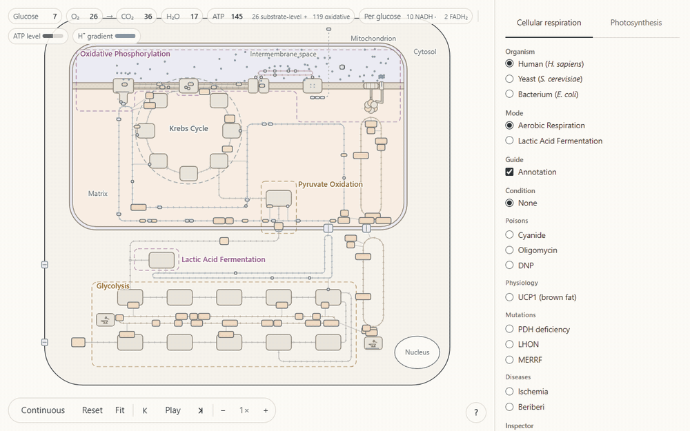
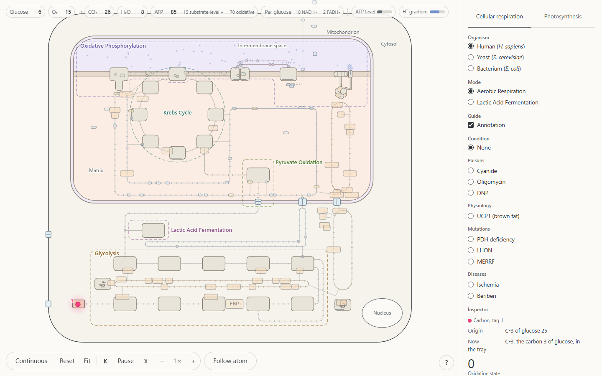

# metasim: simulation of cellular respiration and photosynthesis

An interactive, atom-level simulation of cellular respiration and photosynthesis.
Tag a single atom, press play, and follow it through the pathway, reaction by
reaction.

**Open it: https://nico-chung.github.io/metasim/** · Version 1.0

Click any atom of a glucose, an O₂, a CO₂ or a water molecule and it glows. Press
play and the same atom moves through the pathway: through glycolysis into the
mitochondrion and out as CO₂, or from water to O₂ in a leaf. The inspector reports
the atom's molecule, position, oxidation state and charge at each moment, and
every enzyme, carrier and transporter on the stage can be clicked for a short
description.

- **Cellular respiration** in a human cell, yeast and *E. coli*: aerobic
  respiration, lactic acid and ethanol fermentation, and anaerobic respiration
  with nitrate. Poisons (cyanide, oligomycin, DNP), brown fat, mutations and
  diseases.
- **Photosynthesis** in C3, C4 and CAM leaves: the light reactions, the Calvin
  cycle, photorespiration, darkness, a hot, dry day, the herbicide DCMU and a
  herbicide-resistant weed.

The simulation follows a standard first-year textbook (for example Campbell or
Lehninger). The Model notes panel in the app lists where it simplifies. It runs in
current Chrome, Firefox and Safari on a desktop or tablet.

**Privacy.** The site keeps one flag in your browser's local storage, so the
welcome card shows only on your first visit. It sets no cookies and collects
nothing.

## Suggestions and errors

Found a scientific error, or have a suggestion? Please
[open an issue](https://github.com/nico-chung/metasim/issues).

## About this repository

This repository holds only the published files and is updated automatically
when the app changes. To run it locally, serve the folder over HTTP (ES modules
do not load from `file://`), for example with `npx serve` or
`python -m http.server`, and open the address it prints.

## License

Code: MIT ([LICENSE](LICENSE)). Text: CC BY 4.0 ([LICENSE-TEXT.md](LICENSE-TEXT.md)).
